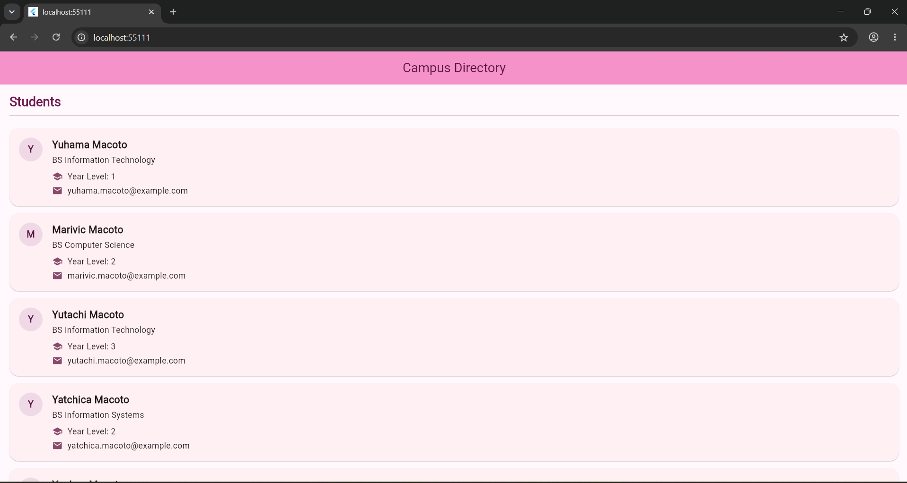

# Laboratory Activity 2

**Name:** Yaohan M. Macoto  
**Activity:** Building a Student Directory with Stateless Widget  
**Project:** Campus Student Directory

## Description

This Flutter application displays a campus student directory using reusable `StatelessWidget` classes. It shows student information, including names, courses, year levels, and email addresses. The application uses `Student`, `DirectoryApp`, `DirectoryScreen`, `SectionHeader`, `StudentCard`, and `InfoRow` to organize the interface into reusable components.

It also uses `Material 3`, a customized theme, and different styles for the student cards and information displayed on the screen.

## Screenshot

